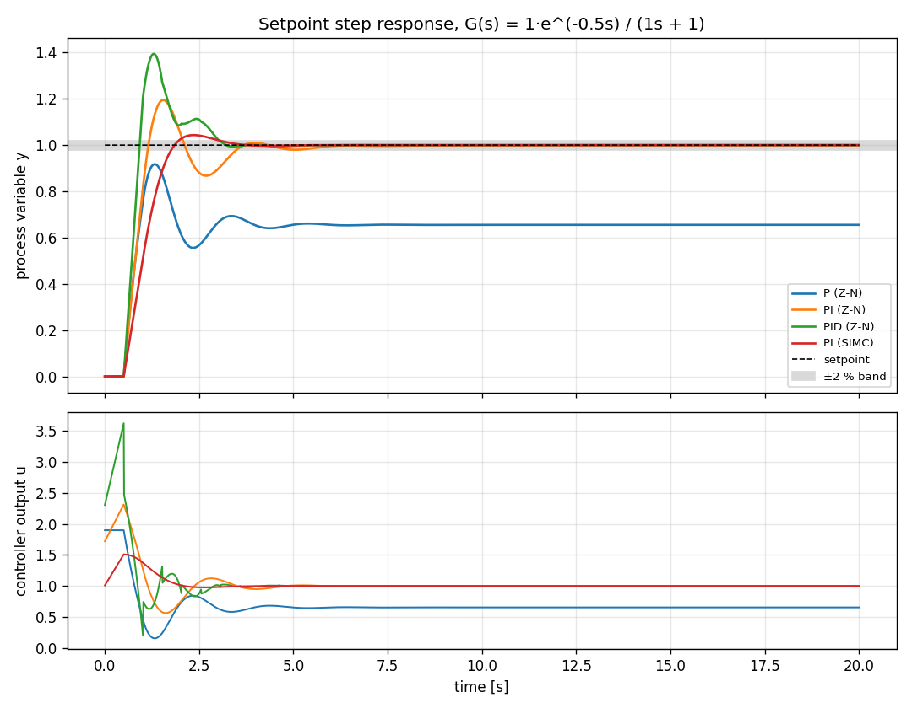

# pid-controller-simulator

[](https://github.com/Dtunder/pid-controller-simulator/actions/workflows/tests.yml)

PID simulation environment with Ziegler-Nichols parameter tuning.

This simulator models a First Order Plus Dead Time (FOPDT) system and runs an automated Ziegler-Nichols tuning process to find optimal Proportional, Integral, and Derivative (PID) parameters.

## Results

Plant: `G(s) = 1·e^(-0.5s) / (1s + 1)` (K = 1, τ = 1 s, θ = 0.5 s, θ/τ = 0.5), unit setpoint step, Δt = 0.01 s, 20 s.
The closed-loop Ziegler-Nichols experiment in `pid.py` finds Ku = 3.80 and Tu = 1.73 s (analytic values for this plant: 3.81 and 1.71 s).
P, PI and PID use the Ziegler-Nichols ultimate-cycle rules; the conservative reference is a SIMC PI controller (Skogestad 2003, τc = θ). Reproduce with `python analysis.py`.



| Controller | Kp | Ki | Kd | Rise time 10-90 % [s] | Overshoot [%] | Settling time 2 % [s] | Steady-state error | IAE |
|---|---|---|---|---|---|---|---|---|
| P (Z-N)   | 1.900 | 0.000 | 0.000 | 0.337 | 40.1 | 4.53 | 0.345 | 7.234 |
| PI (Z-N)  | 1.710 | 1.186 | 0.000 | 0.511 | 19.5 | 5.08 | 0.000 | 1.082 |
| PID (Z-N) | 2.280 | 2.636 | 0.493 | 0.339 | 39.4 | 3.04 | 0.000 | 1.067 |
| PI (SIMC) | 1.000 | 1.000 | 0.000 | 0.943 | 4.4  | 3.04 | 0.000 | 1.084 |

Source: [`results/step_metrics.csv`](results/step_metrics.csv) (values rounded). Rise time, overshoot and settling time are measured relative to each loop's own final value, so for the P controller they describe convergence to 0.655, not to the setpoint.

**Interpretation.** Ziegler-Nichols PID rises about three times faster than SIMC PI (0.34 s vs. 0.94 s) but overshoots by 39 % instead of 4 %; both enter the 2 % band for good at the same 3.04 s and reach almost the same IAE, so the extra aggressiveness buys little for a setpoint step. The pure P controller keeps the expected offset 1/(1 + K·Kp) = 0.345, which only integral action removes. The dead time sets the limit: no controller can react before t = θ = 0.5 s, and the ultimate gain of 3.8 caps the usable loop gain, which is why the Z-N rules (designed for quarter-amplitude decay) land near 40 % overshoot on a plant with θ/τ = 0.5.

**Disturbance rejection.** A second run adds an input load step d = 0.5 at t = 10 s ([figure](results/disturbance_rejection.png), [`results/disturbance_metrics.csv`](results/disturbance_metrics.csv)). Here the aggressive tuning pays off: Z-N PID has the lowest peak deviation (0.201) and the lowest IAE (0.201), and returns to the 2 % band 2.56 s after the step, versus 4.07 s for SIMC PI and 4.68 s for Z-N PI. The P controller does not compensate the load; its offset settles at 0.172 instead of returning to the setpoint.

## CLI Instructions

### Run the Simulator
Run the simulator and tuning process using:
```bash
python main.py
```
This script executes the Ziegler-Nichols tuning algorithm to determine the optimal PID parameters for a defined First Order Plus Dead Time (FOPDT) system. Afterward, it runs a step response simulation using the tuned parameters and saves the results to `results.csv`.

### Run the Analysis
```bash
pip install -r requirements.txt
python analysis.py
```
Writes `results/step_metrics.csv`, `results/step_response.png`, `results/disturbance_metrics.csv` and `results/disturbance_rejection.png`.

### Run the Analysis
```bash
pip install -r requirements.txt
python analysis.py
```
Writes `results/step_metrics.csv`, `results/step_response.png`, `results/disturbance_metrics.csv` and `results/disturbance_rejection.png`.

### Run the Tests
Run all unit tests using the master test runner to ensure all components are functioning correctly:
```bash
python run_all_tests.py
```

## Configuration Setup

The simulation parameters are configured using a `config.json` file located in the root directory, or via environment variables.

### Using `config.json`
A default `config.json` looks like this:

```json
{
  "system": {
    "K": 1.0,
    "tau": 1.0,
    "dead_time": 0.5
  },
  "tuning": {
    "setpoint": 1.0,
    "dt": 0.01,
    "max_time": 50.0
  },
  "simulation": {
    "setpoint": 1.0,
    "dt": 0.01,
    "duration": 30.0,
    "output_file": "results.csv"
  },
  "logging": {
    "level": "INFO"
  }
}
```

### Using Environment Variables
You can override any configuration value using environment variables with the prefix `APP_` followed by the section and key in uppercase.
For example:
- To change the system gain `K` to 2.0: `export APP_SYSTEM_K=2.0`
- To change the simulation duration to 15.0: `export APP_SIMULATION_DURATION=15.0`
- To change the logging level to DEBUG: `export APP_LOGGING_LEVEL=DEBUG`

### Logging Setup

The logging system is configured to output structured JSON logs to the console. The logging level is controlled by the `logging.level` setting in your configuration (e.g., in `config.json` or via `APP_LOGGING_LEVEL`).

## API Reference Documentation

### Core Classes (`pid.py`)

#### `PIDController`
A standard Proportional-Integral-Derivative (PID) controller implementation with anti-windup and output limits.

- **`__init__(self, kp, ki, kd, output_limits=(None, None))`**
  Initializes the controller with tuning parameters (`kp`, `ki`, `kd`) and an optional output limit tuple (`min_limit`, `max_limit`).
- **`reset(self)`**
  Clears the integral accumulator and past error values.
- **`update(self, setpoint, pv, dt)`**
  Calculates the new control variable output given a target `setpoint`, current process variable `pv`, and time step `dt`.

#### `FirstOrderSystem`
Models a First Order Plus Dead Time (FOPDT) system.

- **`__init__(self, K, tau, dead_time, integration_method="exact")`**
  Initializes the system with gain `K`, time constant `tau`, and `dead_time`. The default `exact` method uses the analytical first-order solution for the held delayed input; it remains bounded for large time steps. Select `integration_method="euler"` only to reproduce historical explicit-Euler simulation results (which can become unstable when `dt/tau` is large). This changes numerical outputs compared with earlier releases; use `euler` if you require legacy reproducibility.
- **`reset(self)`**
  Resets the internal state and output values.
- **`update(self, u, dt)`**
  Updates the system state given an input `u` over the time step `dt`. Returns the new system output.

### Core Functions (`pid.py`)

- **`ziegler_nichols_tuning(system, setpoint=1.0, dt=0.01, max_time=50.0)`**
  Performs Ziegler-Nichols tuning on a `FirstOrderSystem` to find optimal PID parameters. Returns `(kp, ki, kd)`.
- **`detect_oscillations(history_y, dt)`**
  Detects if the system output is oscillating at a constant amplitude. Returns `(is_oscillating, period, amplitude_ratio)`.
- **`simulate_and_save(system, controller, filename, setpoint=1.0, dt=0.01, duration=20.0)`**
  Simulates the system with the given controller and saves the `(time, setpoint, pv, cv)` data to a CSV file.

### Utilities (`logger_setup.py`)

- **`configure_logging()`**
  Sets up the root logger to output structured JSON logs to the console using `JSONFormatter`.
